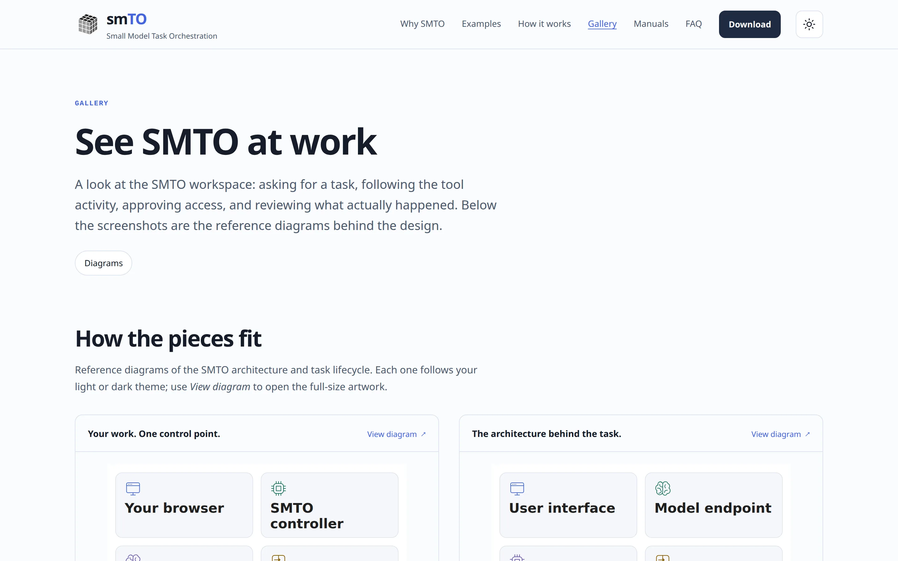
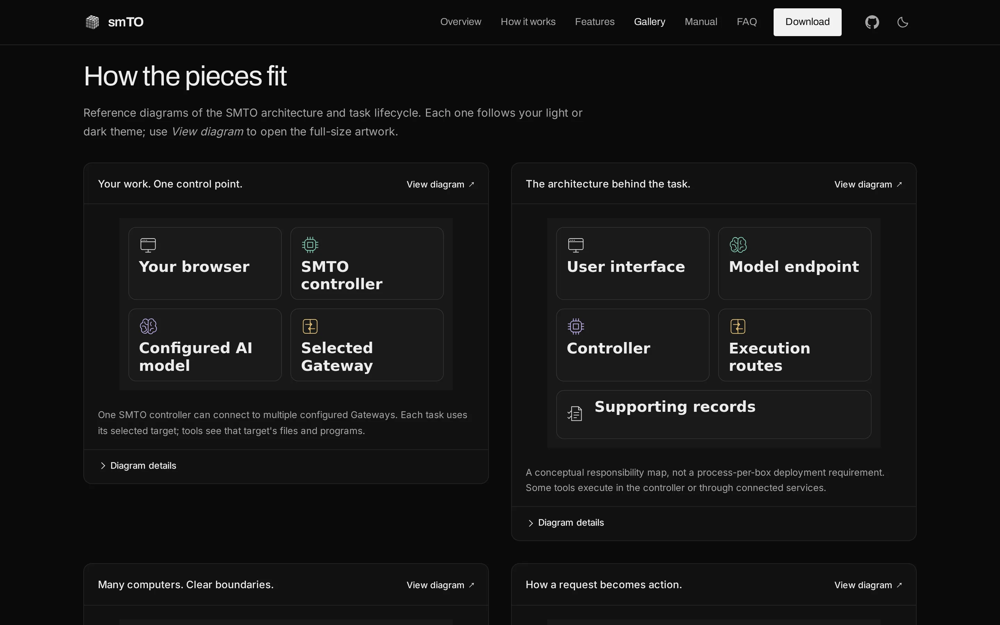
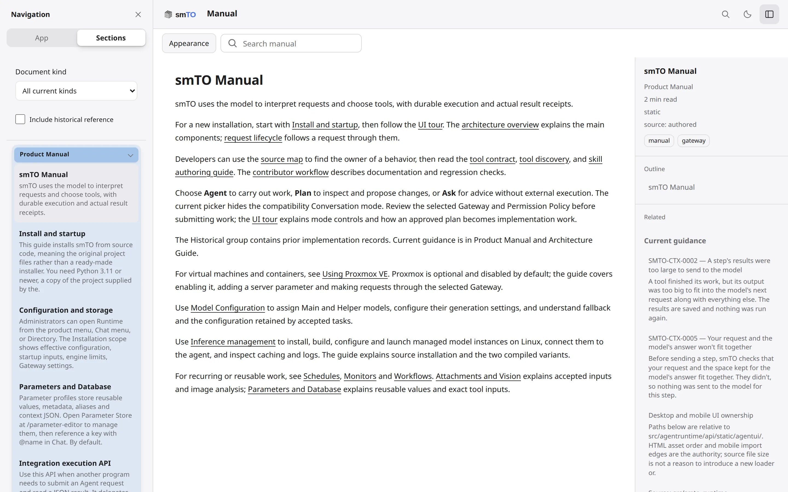
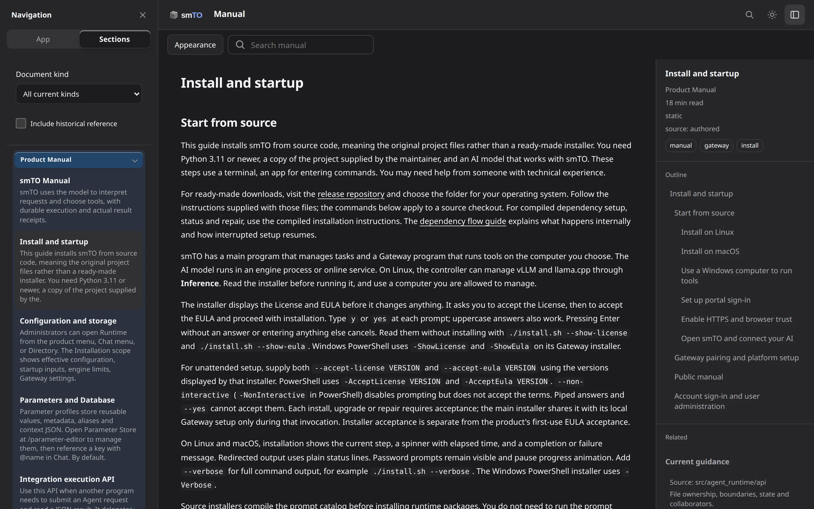
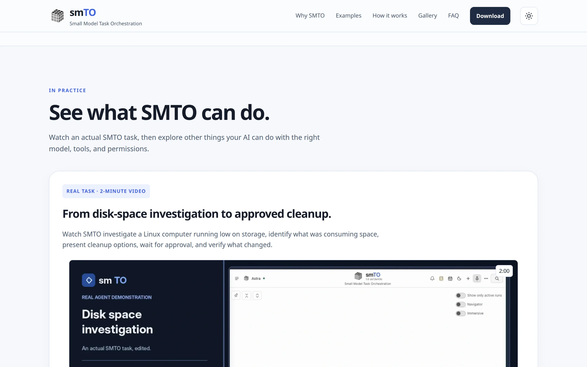
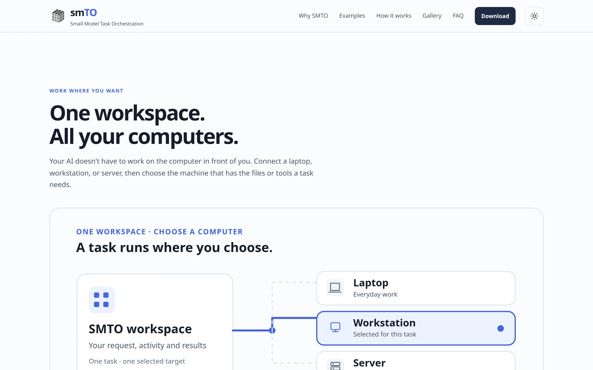
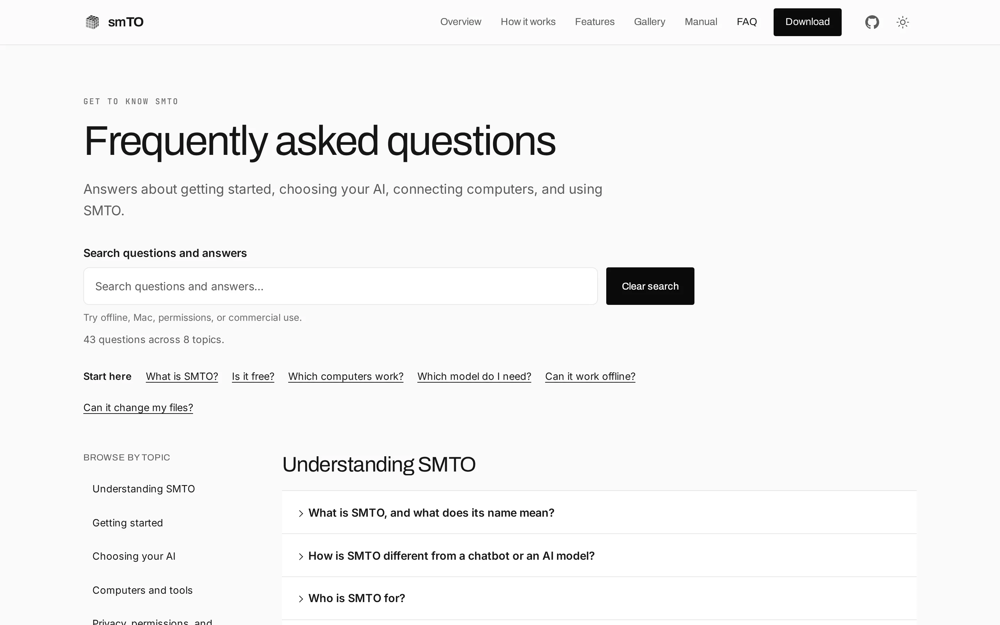
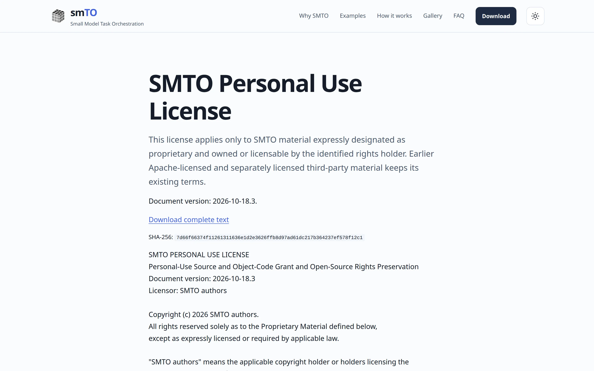
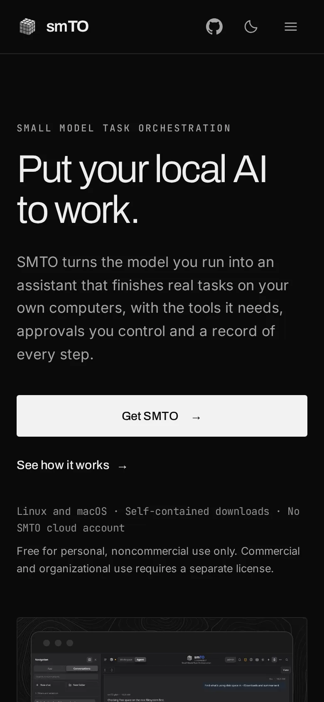
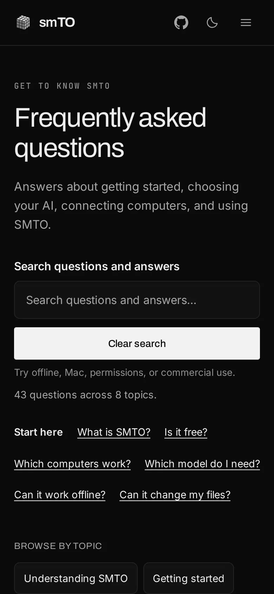

# SMTO website: GitHub Pages edition

This folder holds the static edition of the SMTO public website and product manual, published with GitHub Pages:

**https://vinithbraj.github.io/smto/**

The pages are not a hand-made copy. `tools/build_site.py` imports the real website from the openfabric source (`src/smto_site`), renders every public page through the site's own templates, content files and fingerprinted assets, and writes the result to [`public/`](public/). GitHub serves `public/` as it is.

| Light | Dark |
| --- | --- |
|  |  |
|  |  |
|  |  |

<details>
<summary>More screenshots: home page sections, FAQ, legal, phone</summary>

| | |
| --- | --- |
|  |  |
|  |  |
|  |  |
|  | |

| Phone, light | Phone, dark | FAQ on a phone |
| --- | --- | --- |
|  |  |  |

</details>

## What's on the site

| URL | Content | Source in openfabric |
| --- | --- | --- |
| `/` | Home page: why SMTO, examples, comparison, how it works, computers, models, privacy, downloads | `src/smto_site/templates/home.html` and `content/*.json` |
| `/faq/` | Frequently asked questions with in-page search | `content/faq.json` |
| `/gallery/` | **New on this edition.** 15 product screenshots (desktop and phone, light and dark, with a full-size viewer) and the site's 15 reference diagrams | `site/templates/gallery.html` (this folder); the diagrams come from `src/smto_site/visuals.py` |
| `/manual/` | The full product manual (2,141 documents, about 37 MB): search, deep links (`#doc=…&heading=…`), diagrams, light and dark | `src/manual` |
| `/license/`, `/legal/*` | License, EULA, Apache notices, third-party notices, as HTML and `.txt` | `src/smto_legal` |
| `/releases/`, `/changelog/` | Release index; it is empty until `release_data/releases.json` lists a release | `src/smto_site/release_data` |
| `/docs/*.md`, `/learn/*.md`, `/security.md` | Markdown support documents linked from the home page and FAQ | `content/public_docs.json` |
| `/how-it-works/`, `/learn/…`, `/docs/…`, … | 26 legacy URLs that redirect to the matching home-page section, like the server's 308s | `src/smto_site/routing.py` |
| `sitemap.xml`, `robots.txt`, `feed.xml`, `llms.txt`, `404.html` | Discovery files, rewritten for the GitHub Pages URL | `src/smto_site/discovery.py` |

## Folder layout

```text
site/
├── README.md            # this file
├── build-info.json      # what the last build used: source commit, page and file counts
├── public/              # GENERATED: the published website (do not edit by hand)
├── templates/
│   └── gallery.html     # gallery page; extends the website's base.html
├── overlay/             # files added to the build
│   ├── static/          #   gallery.css, gallery.js (served from /static/)
│   └── screenshots/product/  #   product UI screenshots + manifest.json (captions, alt text)
├── screenshots/         # screenshots of this website, used in this README
└── tools/
    ├── build_site.py    # render the website and manual into public/
    ├── export_manual.py # static export of the product manual (called by build_site.py)
    ├── export_manual_shim.js  # browser shim that answers the manual's API from static files
    ├── check_site.py    # link/asset/URL checks; also runs in the publish workflow
    ├── capture_site.py  # browser check of every page + the README screenshots
    ├── capture_product.py  # stage and capture the product UI screenshots
    └── publish_gh_pages.sh # manual fallback: publish public/ to gh-pages from your machine
```

The publish workflow is in [`../.github/workflows/pages.yml`](../.github/workflows/pages.yml). GitHub only runs workflows from that folder.

## Rebuild after the website changes

The build reads an openfabric checkout and changes nothing in it. Use the openfabric virtualenv, which has the website's dependencies, Playwright and Chromium:

```bash
cd ~/Desktop/smto_release
PY=~/Desktop/openfabric/.venv/bin/python

# 1. Render the website and manual into site/public (wiped and regenerated)
$PY site/tools/build_site.py --source ~/Desktop/openfabric

# 2. Load every page in Chromium (light and dark), fail on any console error,
#    CSP violation or failed request, and refresh the README screenshots
$PY site/tools/capture_site.py

# 3. Publish
git add site .github/workflows/pages.yml
git commit -m "Update website"
git push            # the workflow publishes site/public
```

A full build takes about two minutes, most of it the manual export.

The build ends by running `check_site.py`. A broken link, a missing asset, a leftover root-relative URL or any link to `smtorch.com` fails the build.

To preview locally, run `capture_site.py`; it serves the site at a `/smto/` sub-path, exactly like GitHub. To browse by hand, run `python3 -m http.server -d site/public 8000` and open http://127.0.0.1:8000/. Relative links work at any base path.

### Refresh the product screenshots

```bash
$PY site/tools/capture_product.py --source ~/Desktop/openfabric --out site/overlay/screenshots/product
$PY site/tools/build_site.py --source ~/Desktop/openfabric
```

The capture starts an isolated SMTO controller with scripted model responses and sample files. It never uses your own conversations, settings or running services. `manifest.json` in that folder holds the title, caption and alt text for each image, and the gallery pairs light and dark captures so each visitor sees the version that matches their theme.

## How publishing works

GitHub Pages serves the `gh-pages` branch, which always holds a single commit: a copy of `site/public/`. No repository setting needs changing; GitHub turned Pages on when that branch was first pushed.

- Every push to `main` that changes `site/public/` runs the **Publish website** workflow. It runs `check_site.py`, then force-pushes `site/public/` to `gh-pages`. You can also start it from the **Actions** tab.
- The site updates at https://vinithbraj.github.io/smto/ a minute or two later.
- If the workflow can't run, `site/tools/publish_gh_pages.sh` does the same from your machine over SSH.

Optional: under **Settings → General → About**, set the repository's website to the Pages URL so it shows on the repo home page.

### Custom domain

To serve the site from your own domain instead of `github.io`:

```bash
$PY site/tools/build_site.py --source ~/Desktop/openfabric \
    --site-url https://www.example.com --cname www.example.com
```

Then set the same domain under **Settings → Pages → Custom domain** and point DNS at GitHub Pages. Canonical URLs, the sitemap, the feed and `robots.txt` all follow `--site-url`. The publish workflow refuses to publish when they don't match the domain in `public/CNAME` (or the `github.io` URL when there is none).

## How this edition differs from the server-hosted site

GitHub Pages serves files and can't run the website's FastAPI server, so a few behaviours change:

| Server behaviour | GitHub Pages edition |
| --- | --- |
| Security headers (CSP, frame and referrer policy) on every response | The same Content-Security-Policy is a `<meta>` tag in each page, with hashes recomputed for the final JSON-LD. Header-only directives such as `frame-ancestors` can't be set from a page. |
| 308 redirects for legacy URLs | Small redirect pages (`meta refresh` plus a canonical link) that go to the same home-page section |
| `/manual` served by a separate manual process | Static manual at `/manual/`. Its JSON API answers are precomputed files and search runs in the browser. Manual links on the site point here. |
| Root-relative links (`/faq`) | Relative links (`faq/`), so the site works under `/smto/`; `404.html` uses `/smto/…` because GitHub serves it at any depth |
| `X-Robots-Tag: noindex` on Markdown and text resources | Not possible on static hosting; these files are left out of the sitemap |
| Optional visitor counter and optional CMS | Not included; both need a server. The site's privacy text already describes the counter as optional. |
| Canonical origin is the server's own domain | Canonical URLs point to the GitHub Pages URL. Change it with `--site-url`. |
| Links to the `smtorch.com` domain (footer "SMTO website", legal page headers, FAQ answers, Manuals menu) | Removed, together with the "Visit smtorch.com for details" sentences that only point there |

The additions are the Gallery page and its navigation item. The removals are the `smtorch.com` links and sentences listed above; `build_site.py` (`SMTORCH_REMOVALS`) lists each one. The binding legal documents (`/legal/eula/`, `/legal/proprietary-license/` and their `.txt` files) are published byte-for-byte as shipped with the product, so the address still appears there as plain text, not as a link. The manual's *Install and startup* guide also names it, as plain text, in its section on running the public manual server. All other copy and content is unchanged.

In the manual, `export_manual.py` also repairs links that don't work in the server-hosted manual either: relative `.md` links become `#doc=` links, and links to repository source files keep their text but lose the link.
